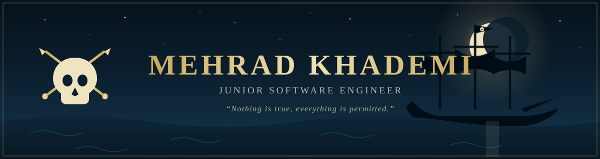

<!-- ⚓ MehradVol4 — Profile README · Black Flag themed ⚓ -->
<!-- Put this file AND banner.svg in a repo named exactly "MehradVol4" -->

 

---

## ⚓ Captain's Log

> *"We work in the dark to serve the light."*

Junior Software Engineer sailing the front-end seas — I build interfaces with **React**, **Next.js**, and **TypeScript**, and I don't leave a voyage until the deck is clean and the types compile. 

- 🧭 **Focus:** Front-end craft, product engineering, clean and well-typed codebases
- ⚔️ **Currently building:** ERP (Next.js + Strapi), dashboards, and a fleet of side projects
- 🗺️ **Learning:** system design, backend, and AI-assisted workflows
- 🦜 **Principle:** ship it, then make it worthy of the flag

---

## ⚔️ Arsenal

---

## 🏴‍☠️ The Fleet

---

## 🧭 Voyage Charts

 

---

*"The truth is written in blood... and in clean commits."*

